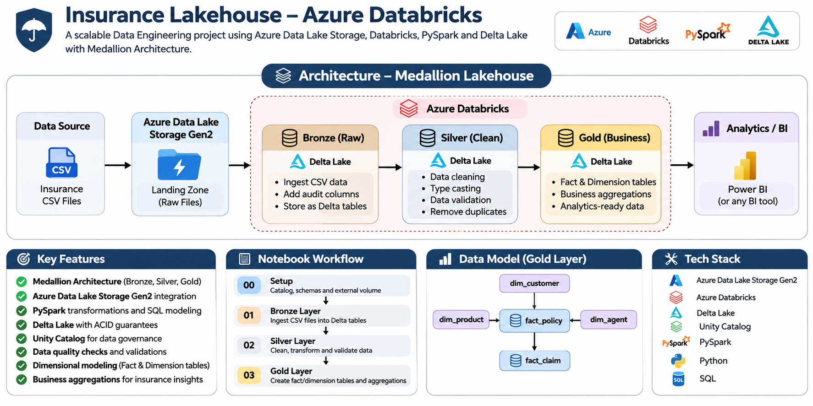

# Insurance Lakehouse — Azure Databricks

A scalable **Data Engineering lakehouse project** built using **Azure Data Lake Storage Gen2, Azure Databricks, PySpark, Delta Lake, and Unity Catalog**.

The project implements a **Medallion Architecture** to ingest, clean, validate, transform, and model insurance data for analytics.

---

## 🏗️ Architecture



### Data Flow

**Insurance CSV Files → ADLS Gen2 Landing → Bronze → Silver → Gold → Analytics / BI**

- **Landing:** Raw insurance CSV files stored in Azure Data Lake Storage Gen2
- **Bronze:** Raw data ingested into Delta tables with audit metadata
- **Silver:** Cleaned, typed, validated, and transformed data
- **Gold:** Business-ready fact, dimension, and summary tables
- **Analytics:** Gold data can be consumed by Power BI or other BI tools

---

## 🚀 Key Features

- 🏗️ **Medallion Architecture** — Bronze, Silver, and Gold layers
- ☁️ **Azure Data Lake Storage Gen2** — Cloud-based data lake
- ⚡ **Azure Databricks + PySpark** — Distributed data processing
- 💾 **Delta Lake** — Reliable ACID-based storage
- 🔐 **Unity Catalog** — Data governance and organization
- 🧹 **Data Cleaning & Transformation** — Automated type casting and standardization
- ✅ **Data Quality Checks** — Row counts, null checks, duplicate detection, and validation
- 🕒 **Audit Columns** — Source file, ingestion timestamp, and source system tracking
- 📊 **Dimensional Modeling** — Fact and dimension tables
- 📈 **Business Aggregations** — Insurance portfolio and claims analytics
- 🧪 **Gold Layer Validation** — Automated validation of key metrics

---

## 📂 Project Structure

```text
insurance-lakehouse-databricks/
│
├── insurance_project_manual/
│   ├── 00_setup.ipynb
│   ├── 01_bronze.ipynb
│   ├── 02_silver.ipynb
│   └── 03_gold.ipynb
│
├── Ext_notebook.ipynb
├── docs/
│   └── architecture.png
│
└── README.md
```

---

## 📓 Notebook Workflow

### `00_setup.ipynb`

Initial project configuration.

Creates:

- Unity Catalog
- Catalog and schemas
- Landing volume
- Required project structure

```text
insurance_project
├── landing
├── managed
├── bronze
├── silver
└── gold
```

---

### `01_bronze.ipynb`

Ingests raw CSV files from the ADLS Gen2 landing zone.

Key operations:

- Reads insurance CSV files using PySpark
- Validates expected record counts
- Adds audit columns
- Stores data as Delta tables
- Performs ingestion-level validation

Example audit columns:

```text
_source_file
_ingested_at
_source_system
```

---

### `02_silver.ipynb`

Transforms Bronze data into clean and structured datasets.

Key operations:

- String trimming
- Empty-string → NULL conversion
- Data type conversion
- Numeric and percentage conversions
- Boolean conversions
- Primary-key validation
- Cast-failure detection
- Data quality checks

The Silver layer produces **clean, typed, analytics-ready datasets**.

---

### `03_gold.ipynb`

Creates business-ready datasets using PySpark and SQL.

### Dimension Tables

```text
dim_customer
dim_product
dim_agent
```

### Fact Tables

```text
fact_policy
fact_claim
```

### Summary Tables

```text
insurance_portfolio_summary
claims_monthly_summary
```

These tables support insurance business analysis and reporting.

---

## 📊 Gold Layer Data Model

```text
                    dim_customer
                         │
                         ▼
dim_product ───────► fact_policy ◄────── dim_agent
                         │
                         ▼
                     fact_claim
```

The Gold layer follows a **dimensional modeling approach** suitable for analytical workloads.

---

## ✅ Data Quality & Validation

The pipeline includes validation checks across the Bronze, Silver, and Gold layers.

Examples include:

- Expected row-count validation
- Primary-key uniqueness
- Duplicate detection
- Null handling
- Data type validation
- Failed type-cast detection
- Business metric validation
- Fact table record-count validation

Gold-layer validation verifies key insurance metrics before completion.

---

## 🛠️ Technology Stack

| Technology | Purpose |
|---|---|
| **Azure Data Lake Storage Gen2** | Cloud data lake / landing zone |
| **Azure Databricks** | Data Engineering platform |
| **PySpark** | Distributed data processing |
| **Delta Lake** | Reliable table storage |
| **Unity Catalog** | Governance and data organization |
| **Python** | Data transformation |
| **SQL** | Data modeling and analytics |

---

## 🔄 Pipeline Flow

```text
Insurance CSV Files
        │
        ▼
Azure Data Lake Storage Gen2
        │
        ▼
┌─────────────────┐
│ Bronze Layer    │
│ Raw + Audit     │
└─────────────────┘
        │
        ▼
┌─────────────────┐
│ Silver Layer    │
│ Clean + Typed   │
└─────────────────┘
        │
        ▼
┌─────────────────┐
│ Gold Layer      │
│ Business Ready  │
└─────────────────┘
        │
        ▼
Analytics / BI
```

---

## 🎯 Project Objective

The objective of this project is to demonstrate a practical **end-to-end Data Engineering pipeline** using Azure Databricks and modern lakehouse architecture.

The project focuses on:

- Cloud data ingestion
- Distributed processing
- Data quality
- Delta Lake
- Medallion Architecture
- Dimensional modeling
- Business analytics
- Data governance

---

## 📌 Skills Demonstrated

**Data Engineering**

- ETL / ELT pipelines
- Data ingestion
- Data transformation
- Data validation
- Data modeling
- Lakehouse architecture

**Azure**

- Azure Data Lake Storage Gen2
- Azure Databricks
- Unity Catalog
- External locations and storage credentials

**Programming & Analytics**

- Python
- PySpark
- SQL
- Delta Lake

---

## 👨‍💻 Author

**Vinayak D**

Computer Science & Engineering | Data Engineering

GitHub: [vinayak-30-debug](https://github.com/vinayak-30-debug)

---

⭐ If you find this project useful, consider giving the repository a star.
